# Blockprint

**Turn a floor plan into a house you can walk through, with friends, in the browser.**

Upload a photo or PDF of a floor plan. Claude reads every room, wall, door, window, stair and courtyard,
asks you a few questions (pre-filled with everything it found on the plan), then the house is built block
by block, furnished, and moved into a shared city where every visitor sees everyone else and all the
other houses, like neighbours on the same street.

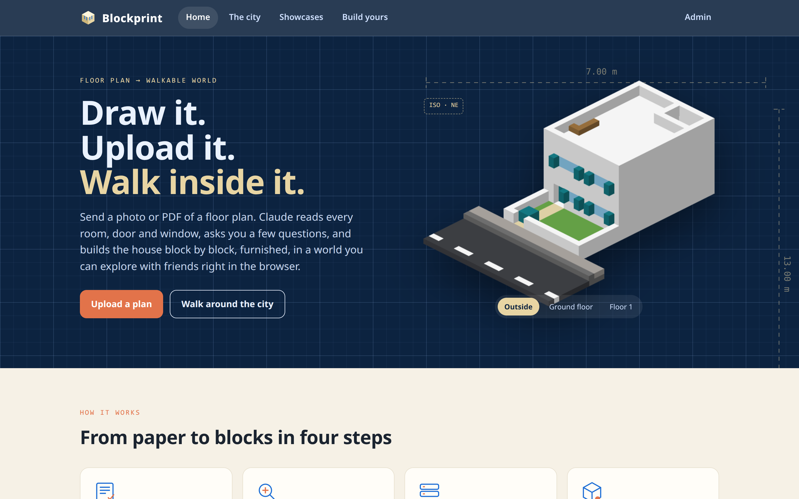

## Contents

- [What it does](#what-it-does)
- [Tour](#tour)
- [How it works](#how-it-works)
- [Run it yourself](#run-it-yourself)
- [Tests](#tests)
- [Project layout](#project-layout)
- [Plan format](#plan-format)
- [Limitations](#limitations)
- [Credits and licenses](#credits-and-licenses)

## What it does

| | |
|---|---|
| **Reads plans** | Claude (Opus) reads images or PDFs, one or several floors, and returns structured geometry in meters: rooms with their labels, walls, doors, windows, stairs and their direction, spaces open to the sky. Every fact is marked *from the plan* or *guessed*, with the evidence. |
| **Asks only what it must** | A questionnaire is generated from that reading. What is written on the plan is pre-filled and folded away; guesses are highlighted; anything unknown must be answered. Per room: what it is, who sleeps there, which equipment. Per open space: is it covered, what is it, which ground, which wall. |
| **Builds** | A compiler turns facts + answers into a block plan: rotates the house so its street side faces the street, snaps to the chosen scale (25 cm, 50 cm or 1 m per block), places real-size open doors, shutters, stairs with headroom, roof terrace and parapets, and lays out furniture automatically (beds with nightstands, wardrobes, desks, sofa facing the TV, dining table with chairs, kitchen counter with oven, sink and fridge, toilet, sink and shower). Every house is checked to be enterable from the street. |
| **Three styles** | Traditional Tunisian (white walls, blue doors and shutters, patterned tiles), Modern, Classic wood. |
| **One shared city** | Every published house gets a permanent plot along the city streets, next to the others, around a plaza. One multiplayer server for everyone: visitors see each other, chat, and walk from house to house. New houses appear live, without a restart. |
| **In the browser** | No account, no game install: the 3D explorer is the open-source [minecraft-web-client](https://github.com/zardoy/minecraft-web-client). |
| **On phones** | Every page is responsive. On a phone or tablet the explorer opens full screen with touch controls (left thumb walks, right thumb looks, buttons to jump, fly and chat). |
| **Lighting** | Worlds are written with real sky light and block light: ceiling lights, bedside lanterns and street lamps light the rooms and streets, daylight comes in through windows, doors and courtyards. |
| **Take it home** | Download any house as a Minecraft Java world (1.21.4, upgraded automatically by newer versions) or as a datapack. |
| **Admin** | Enable or disable houses (live), allow visitors to build on a given plot, reset a house, rebuild, change the answers, feature on the home page, restart the city. |

## Tour

### The city

Every house stands on its plot along the streets. The live map shows who is where; click a house to land on its sidewalk.

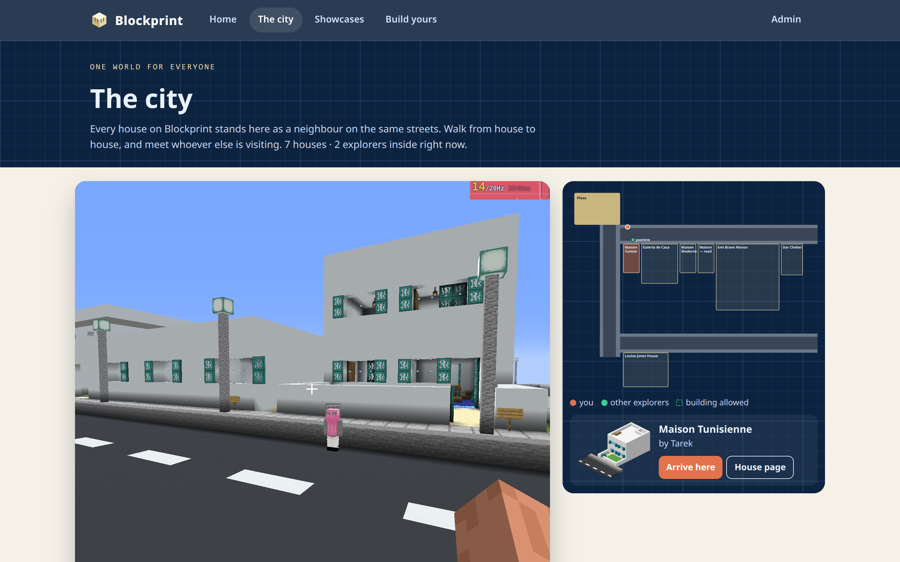

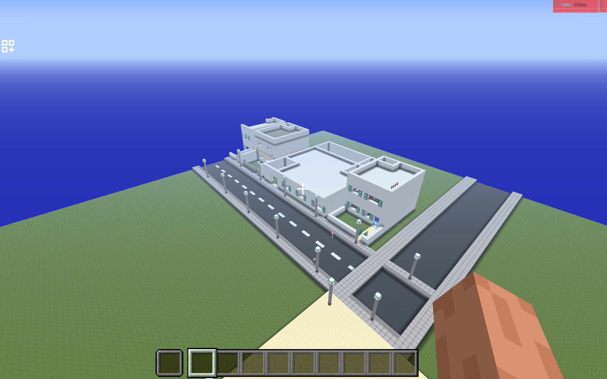

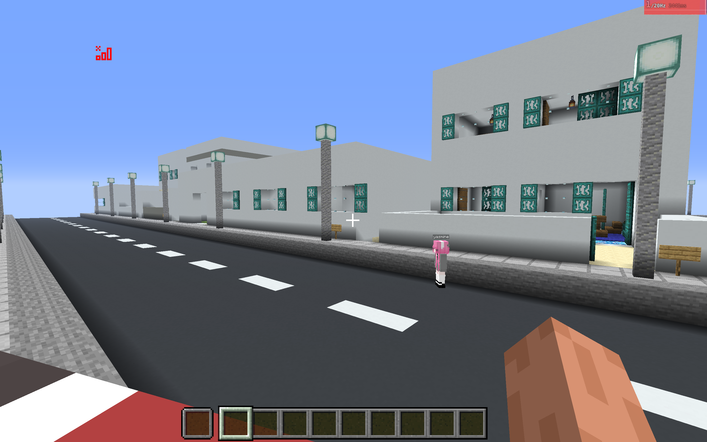

### Inside a house

Furniture is placed automatically for the type of each room and the answers (who sleeps here, which equipment).

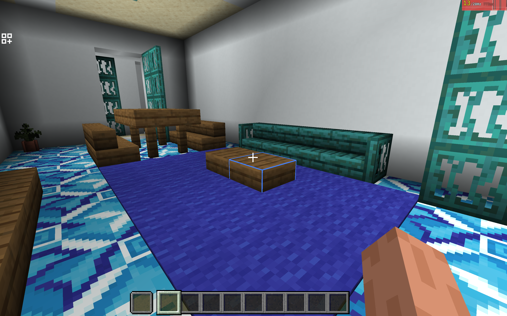

### On a phone

<p>
  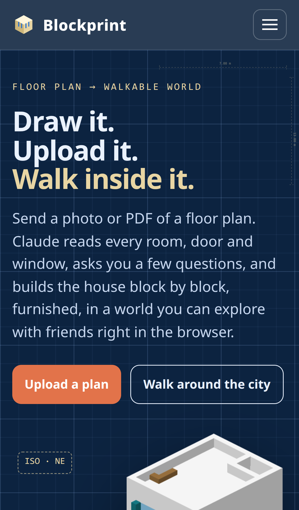
  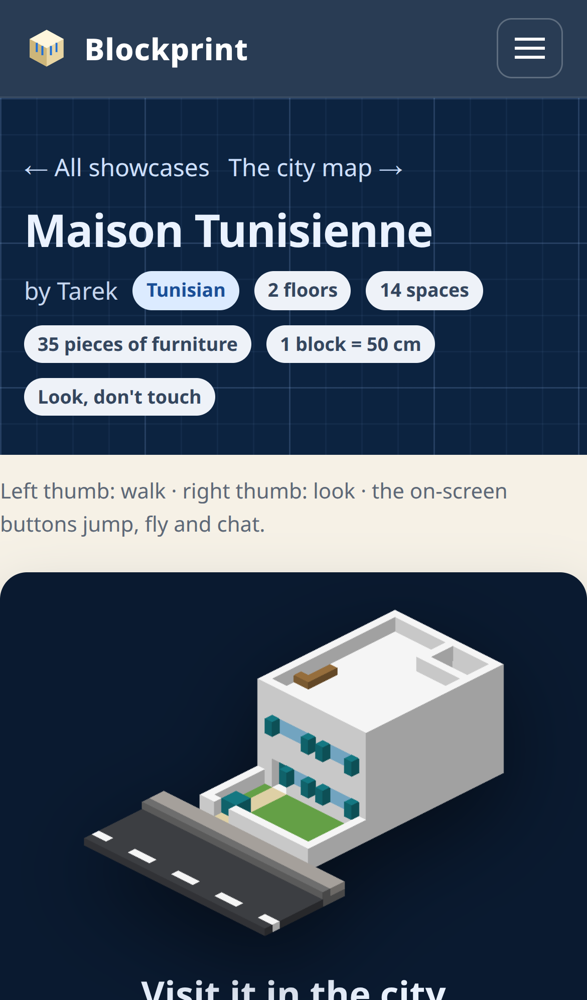
  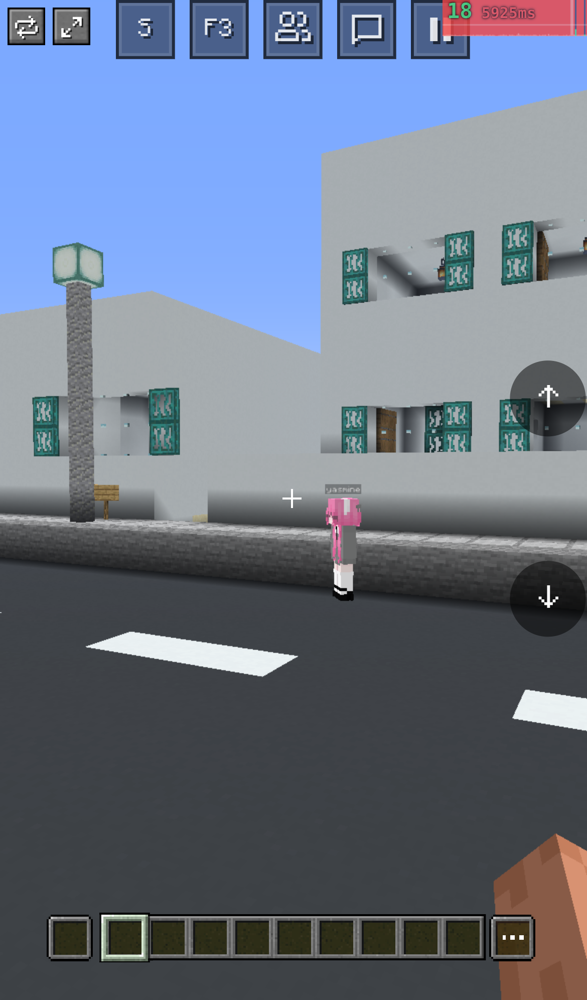
</p>

### Every house has a showcase page

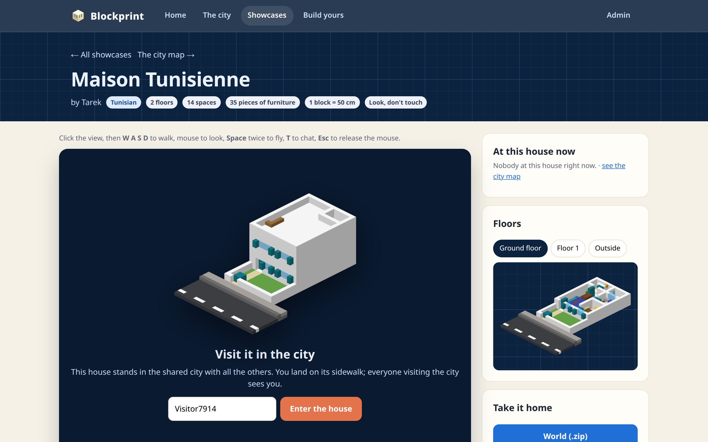

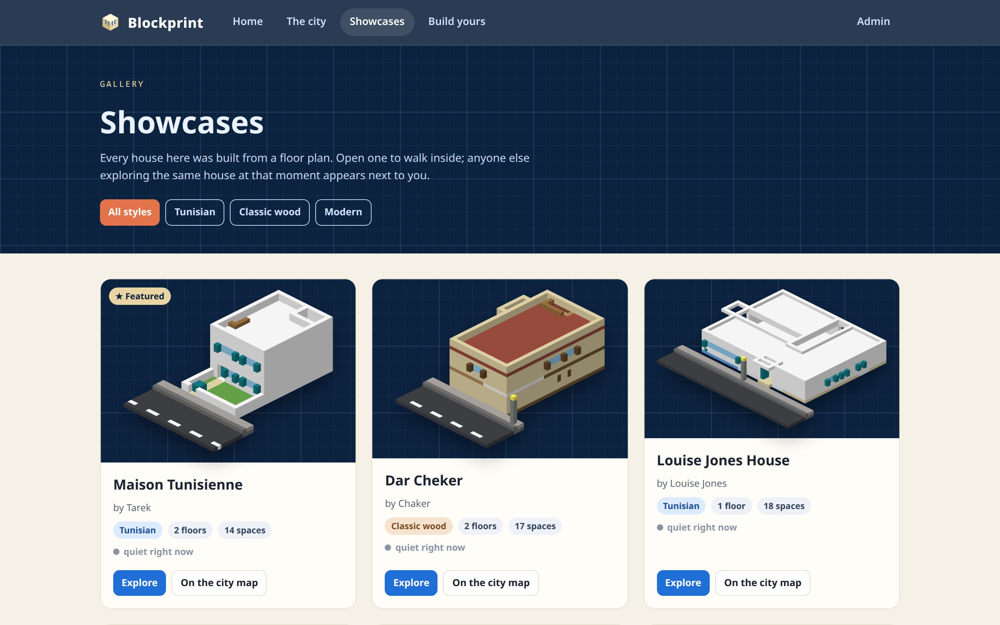

Isometric pictures and per-floor cutaways are rendered from the blocks themselves:

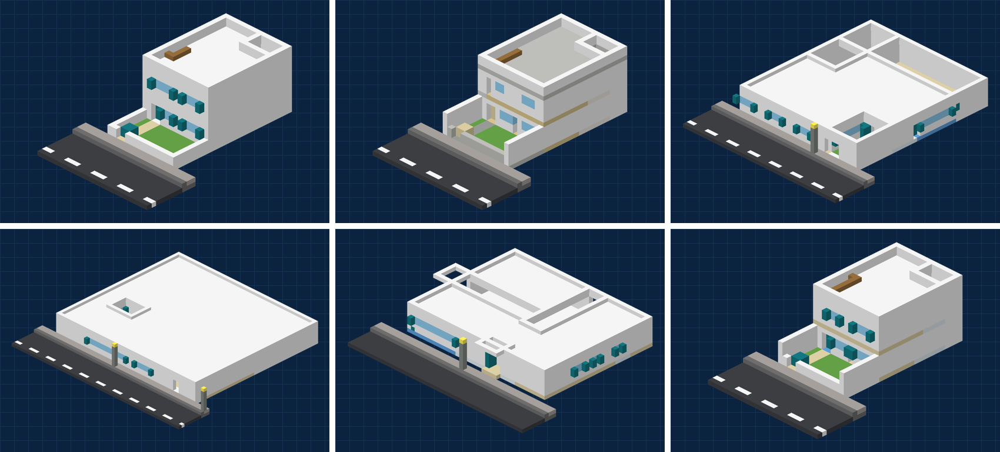

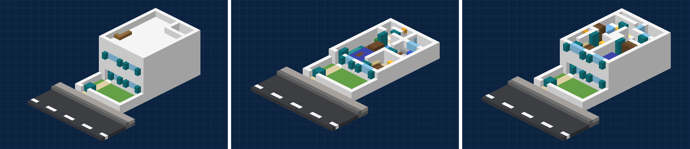

### Build yours

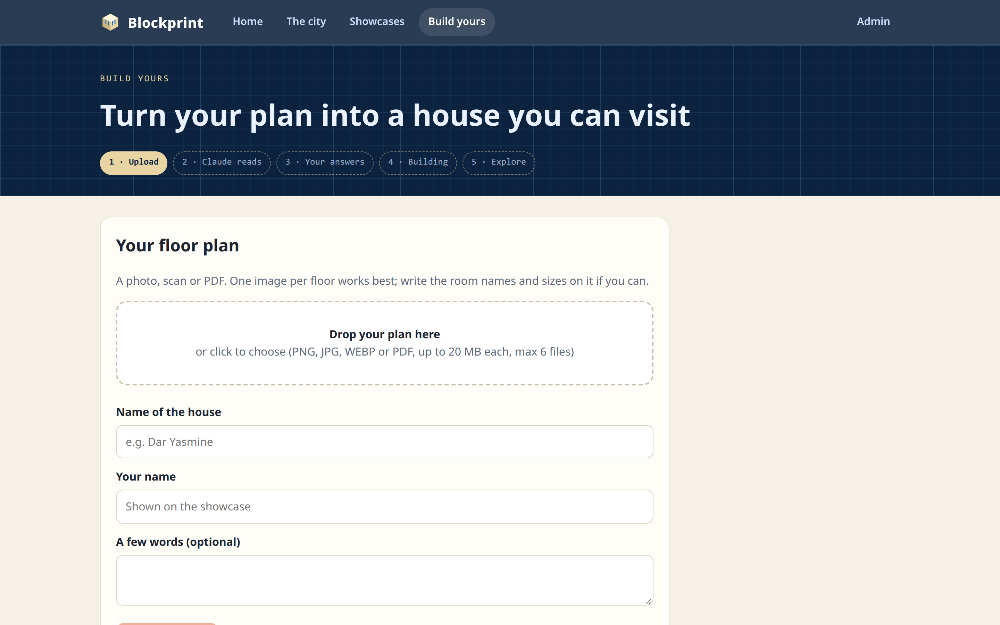

While Claude reads the plan, a scan line runs over the drawing. Then the questionnaire: green = from the plan,
amber = Claude's guess, grey = default. A mini-plan of each floor highlights the space you are answering about.

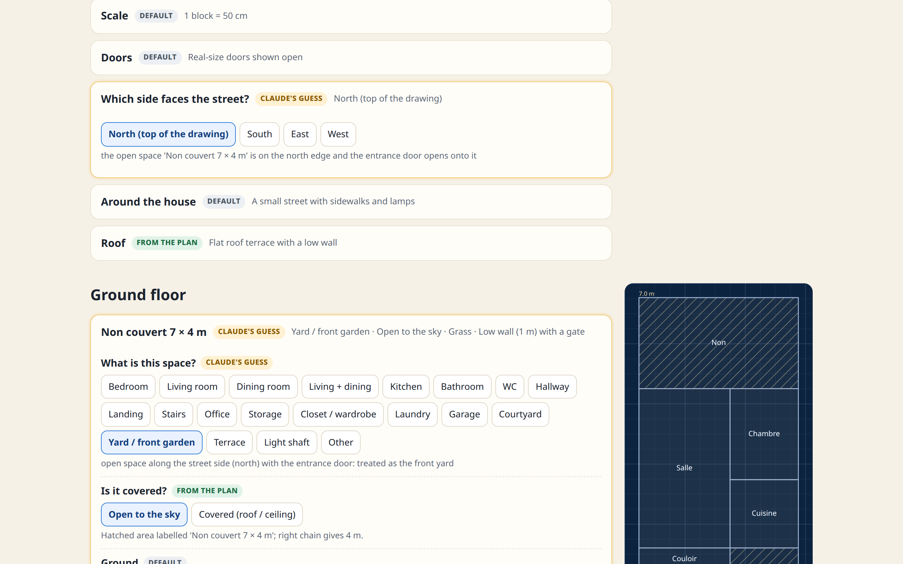

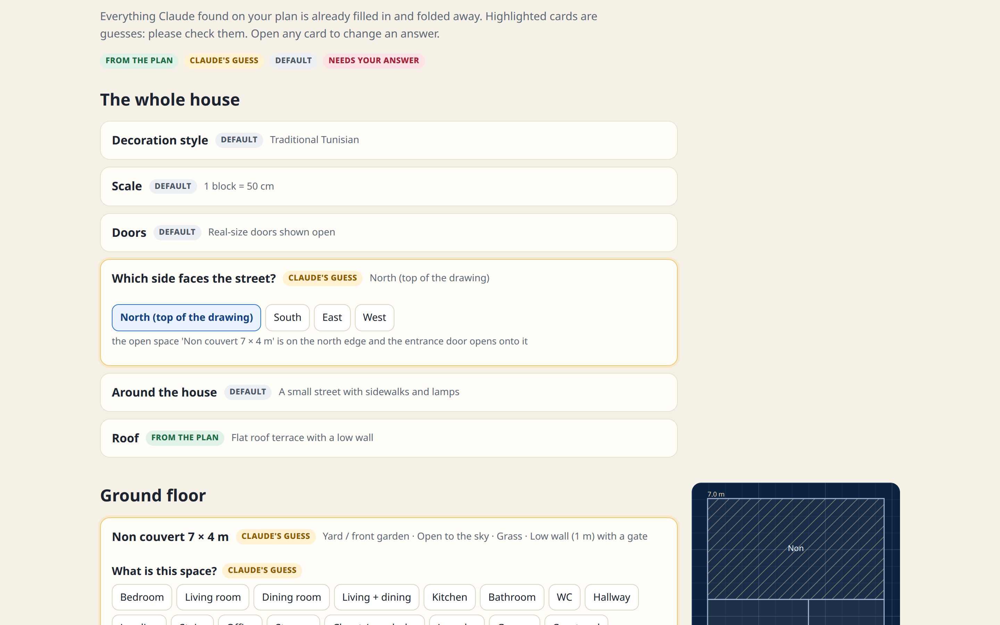

### Admin

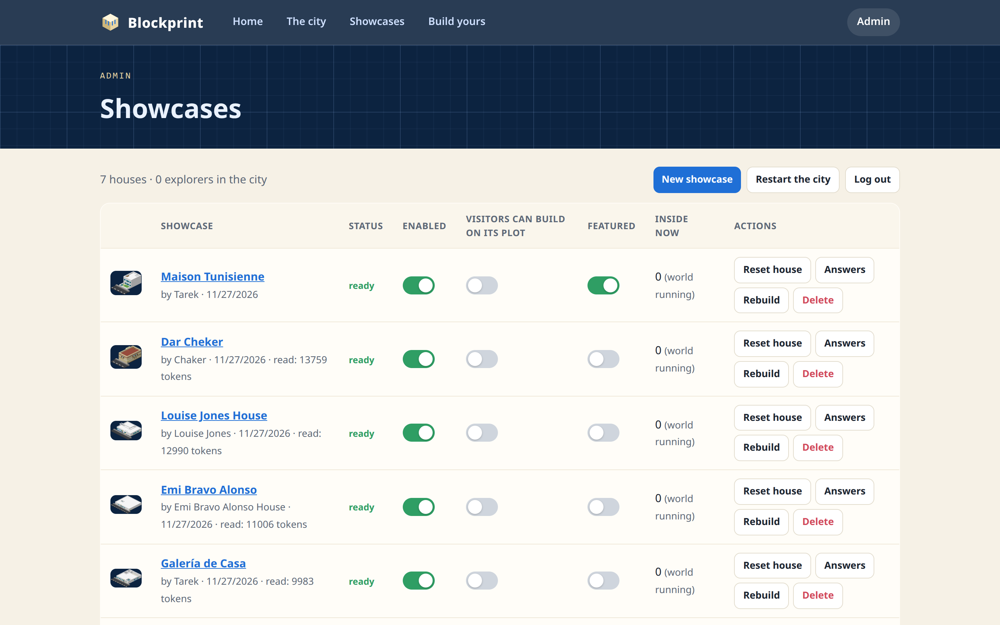

### Block by block

Every layer of a house seen from above (y = ground floor to roof), generated with each build:

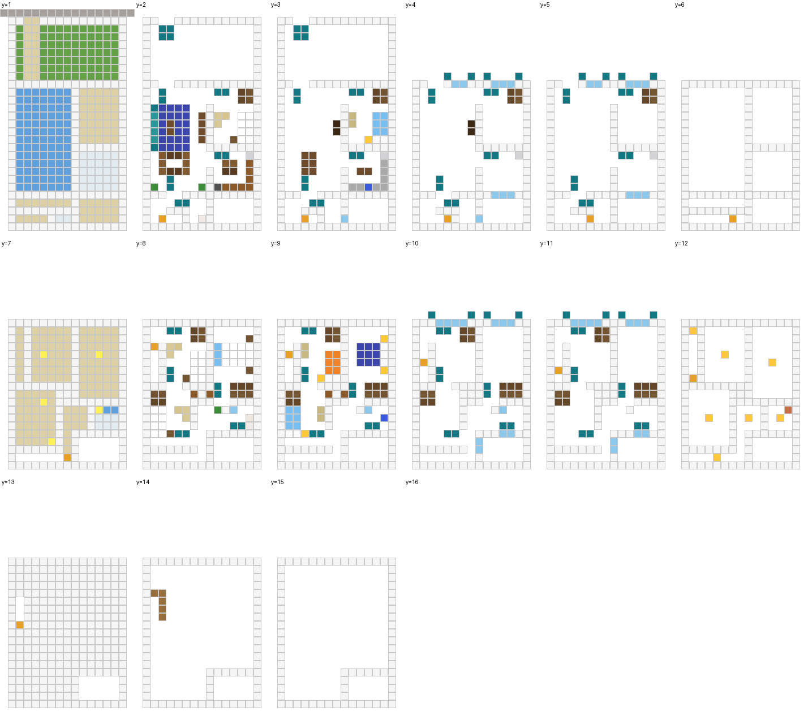

## How it works

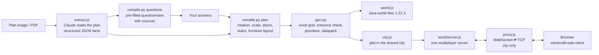

1. **Reading** (`app/src/extract.js`): the plan files go to `claude-opus-5-5` with a JSON schema (structured outputs). The answer is a list of floors in one shared coordinate system, each with an outline, spaces (label, rectangle, type, covered/open, source, evidence), wall center lines, openings (door / window / opening, which two spaces they connect), stairs (direction of climb, to the next floor or the roof) and the list of assumptions. About 1 to 2 minutes and a few cents per plan.
2. **Questionnaire** (`compile.py questions`): one card per space and per stair plus whole-house questions (style, scale, doors, street side, surroundings, roof). Each value carries its source.
3. **Compiling** (`compile.py plan`): applies the answers; rotates so the street is north; removes empty margins Claude may have estimated around the building; snaps to the block grid; turns open ground-floor spaces along the street into a front yard with a low wall and gate; keeps outer walls open along decks and patios; cuts stair openings in the floor above; picks the side and hinge of every open door panel so it does not block anything; places furniture room by room.
4. **Generating** (`gen.py`): builds a voxel grid (walls, floors with patterns, windows with shutters, doors, stairs with headroom, roof, parapets, lights, furniture), checks that you can walk in from the street (and opens a passage if not), and writes the previews, the isometric pictures, the datapack and the block list.
5. **World files** (`app/src/world.js`): writes real Minecraft region files and `level.dat` directly with the Prismarine libraries (no Mojang server needed): flat ground, the house, block entities (signs), and lighting computed by a small light engine: sky light falls down each column until a block stops it and then spreads sideways, block light spreads from every light-emitting block, both losing one level per block and stopped by opaque blocks (values from minecraft-data). The city is lit in well under a second.
6. **The city** (`app/src/city.js`, `app/src/worlds.js`, `app/src/worldserver.js`): plots are allocated in rows along streets and never move. One [space-squid](https://github.com/zardoy/space-squid) server runs the whole city from a throwaway copy (visitors' changes are never saved; a reset or restart brings back the published houses). The website talks to it over IPC to land visitors in front of the house they chose, paste new houses live, clear disabled ones, and allow building per plot.
7. **Proxy** (`app/src/proxy.js`): browsers cannot open TCP sockets, so the site bridges WebSocket to the city server, using the same protocol as the web client's own proxy, but it only ever connects to the city.

### Fixes to the multiplayer server

The JavaScript server needed a few patches for Minecraft 1.21.4 (all in `app/src/worldserver.js`, applied at runtime, no fork):
players are spawned with `spawn_entity` and a velocity vector (the old `named_entity_spawn` packet was removed in 1.20.2, so visitors were invisible to each other),
players already inside are announced to a newcomer only after the player list (otherwise their names were missing),
`entity_teleport` uses the 1.21.2+ format, disconnect reasons are always text, and joining twice with the same name replaces the older session.

## Run it yourself

Requirements: Node.js 22+, Python 3.10+ with Pillow, `zip`/`unzip`, and an Anthropic API key for reading plans.
Google Chrome (or Chromium) is only needed for the end-to-end tests and screenshots.

```bash
git clone https://github.com/taghouti-org/blockprint.git
cd blockprint/app
npm install
pip install pillow
./scripts/fetch-client.sh            # downloads minecraft-web-client into app/vendor/mwc

mkdir -p ~/.config/plan2world
cat > ~/.config/plan2world/env <<EOF
ANTHROPIC_API_KEY=sk-ant-...
ADMIN_PASSWORD=choose-a-password
SESSION_SECRET=$(openssl rand -hex 32)
EOF
chmod 600 ~/.config/plan2world/env

./run.sh start                         # http://127.0.0.1:8090
./run.sh status | stop | restart
```

On the first start the site seeds two sample houses and builds the city. The server listens on localhost only;
to share it privately we use [Tailscale Serve](https://tailscale.com/kb/1312/serve) (`tailscale serve --bg --https=443 http://127.0.0.1:8090`).

| Setting (env) | Default | |
|---|---|---|
| `ANTHROPIC_API_KEY` | none | needed to read plans |
| `ADMIN_PASSWORD` | none | the admin area is locked without it |
| `SESSION_SECRET` | random | signs the admin cookie |
| `PORT`, `HOSTS` | `8090`, `127.0.0.1` | web server |
| `CITY_PORT` | `25700` | city server (localhost) |
| `MAX_READS_PER_DAY` | `20` | cap on Claude readings |
| `DATA_DIR` | `data/showcases` | where showcases are stored |

### Only the generator

The pipeline also works without the website:

```bash
python3 gen.py house_plan.json build      # previews, isometric pictures, datapack, block list
node app/src/world.js build/blocks.json build/world/MyHouse   # a Java world + zip
```

## Tests

```bash
cd app
npm test              # 13 unit tests: every style x scale compiles to a valid world, questionnaire sources, rotation, world round-trip
npm run test:e2e      # browsers: two visitors meet in the city, admin controls with a scripted player, every page on desktop and phone,
                      # and on an emulated iPhone: no page scrolls sideways, the city opens full screen with touch controls
npm run test:create   # full upload -> Claude reading -> questionnaire -> build in the browser (spends one real API call)
node scripts/screenshots.js   # regenerates docs/screenshots
```

## Project layout

```
compile.py               facts + answers -> block plan; also produces the questionnaire
gen.py                   block plan -> voxel grid, entrance check, previews, isometric pictures, datapack
house_plan.json          the hand-tuned sample house (plan format example)
app/
  server.js              website, API, admin, uploads, city wiring
  run.sh                 start / stop / restart / status
  src/extract.js         Claude reading (structured outputs)
  src/store.js           showcases on disk and the build pipeline
  src/world.js           Java world writer (region files, level.dat)
  src/blockstate.js      "minecraft:oak_stairs[facing=east]" -> state id, with defaults
  src/city.js            plots, streets, plaza, signs, city world
  src/worlds.js          runs the city server, IPC
  src/worldserver.js     the multiplayer server + 1.21.4 fixes
  src/proxy.js           WebSocket <-> TCP bridge (city only)
  public/                the website (home, city, showcases, showcase, create, admin)
  scripts/               fetch-client.sh, screenshots.js
  test/                  unit + end-to-end tests, fixtures
docs/                    original app spec, screenshots
```

## Plan format

`house_plan.json` is the block plan `gen.py` builds from (meters, x west to east, z north to south, the street to the north).
Levels have a footprint, floors (block or tile pattern per room), wall center lines, openings (doors with an open panel side and hinge,
windows with shutters), lights and furniture (`bed`, `sofa`, `table`, `desk`, `wardrobe`, `nightstand`, `counter`, `fridge`, `toilet`,
`sink`, `shower`, `tv`, `rug`, `plant`, `barrel`). Plus the roof, stairs, yard and street. See the sample file and `compile.py`.

## Limitations

- Plans without written dimensions are scaled from what Claude can recognise (car, bed and door sizes), so sizes are approximate.
- Only rectangular, axis-aligned rooms and walls; no curved or diagonal walls, no pitched roofs.
- Changes made by visitors (on plots where building is allowed) are not saved: a reset or a city restart brings the published house back.
- A house added to a running city is lit and gets its name sign when the city next rebuilds; this happens automatically as soon as nobody is inside.
- The browser client renders a subset of Minecraft; the downloadable world is the reference.

## Credits and licenses

- 3D explorer: [zardoy/minecraft-web-client](https://github.com/zardoy/minecraft-web-client) (MIT), downloaded by `fetch-client.sh`, not included.
- Multiplayer server: [space-squid / @zardoy/flying-squid](https://github.com/zardoy/space-squid) (MIT).
- World files and protocol: [PrismarineJS](https://github.com/PrismarineJS) (MIT).
- Plan reading: [Claude](https://www.anthropic.com/claude) by Anthropic.
- Not an official Minecraft product. Not approved by or associated with Mojang or Microsoft.

This project is released under the [MIT license](LICENSE).
